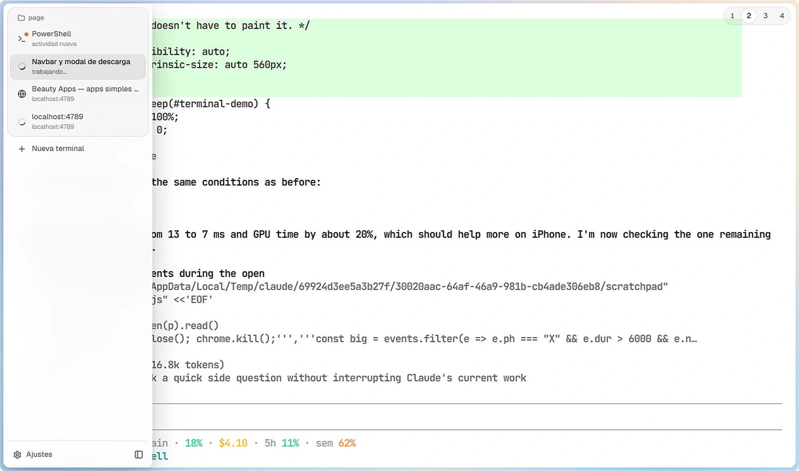

<p align="center">
  
</p>

<h1 align="center">Beauty Shell</h1>

<p align="center">The most beautiful terminal for Windows.</p>

<p align="center">
  <a href="https://github.com/fabriciovla/BeautyShell/releases/latest"></a>
  <a href="https://github.com/fabriciovla/BeautyShell/actions/workflows/build.yml"></a>
  <a href="LICENSE"></a>
</p>

<p align="center">
  
</p>

## Features

- **Sessions by folder.** Tabs group themselves by project in a glass sidebar, each with its live status: working,
  new activity, waiting for an answer or done.
- **Split panes.** Drag a tab onto the terminal to split it in any direction, and drag the divider to resize.
- **Built-in browser.** Open your local dev server right next to the terminal that runs it.
- **Agents that work together.** Claude Code and other coding agents can list, read and message each other's
  sessions through a local MCP server.
- **Suggestions as you type.** PowerShell commands you ran in the same folder appear in gray; Tab or → accepts them.
- **Command palette and workspaces.** Every action one search away, and saved layouts that reopen with the commands
  that were running in each pane.
- **Notifications.** When a long command or an agent finishes while the window is in the background, Windows tells you.
- **Your look.** Light or dark, acrylic or Mica glass, fonts and cursor, all live.
- **English and Spanish,** following the Windows display language.

## Download

[Download BeautyShellSetup.exe](https://github.com/fabriciovla/BeautyShell/releases/latest/download/BeautyShellSetup.exe)
and run it, on Windows 10 or 11 (x64). Beauty Shell updates itself in the background.

The installer is not code-signed yet, so SmartScreen may show a warning: choose **More info → Run anyway**.

## Shortcuts

| Action | Shortcut |
| --- | --- |
| New terminal in the same folder | Ctrl+T |
| Close pane / tab | Ctrl+W / Ctrl+Shift+W |
| Reopen the last closed | Ctrl+Shift+T |
| Next / previous tab | Ctrl+Tab / Ctrl+Shift+Tab |
| Go to tab 1–8 / the last one | Ctrl+1–8 / Ctrl+9 |
| Find in the terminal | Ctrl+F |
| Split right / down | Ctrl+Shift+D / Ctrl+Shift+E |
| Move between panes | Alt+arrows |
| Zoom the active pane | Ctrl+Shift+Z |
| Jump between commands | Ctrl+↑ / Ctrl+↓ |
| Command palette | Ctrl+Shift+P |
| Sidebar | Ctrl+Shift+B |
| Font size | Ctrl+= / Ctrl+- / Ctrl+0 |
| Quake mode | Win+` |
| Settings | Ctrl+, |

## How it works

Beauty Shell is a [Tauri 2](https://tauri.app) app. The window is drawn by WebView2 with
[xterm.js](https://xtermjs.org) and WebGL, and each terminal runs on a Windows pseudoconsole (ConPTY) owned by the
Rust side. PowerShell is wrapped with a small prompt integration that reports the current folder and marks each
command (OSC 133), which drives the folder groups, the suggestions and jumping between commands.

```
src/              frontend in TypeScript, without a framework
  main.ts         startup, tabs, drag and drop, shortcuts, persistence
  session.ts      one pane: xterm, its pseudoconsole, title, folder and activity
  layout.ts       split pane tree
  settings.ts     settings page
src-tauri/src/
  pty.rs          pseudoconsole sessions and the PowerShell integration
  mcp.rs          local MCP server for messages between sessions
  browser.rs      built-in browser views
page/             the Beauty Apps website
```

## Building

Requirements: Node 20 or newer, Rust (`stable-x86_64-pc-windows-msvc`) and Visual Studio Build Tools with the
**Desktop development with C++** workload.

```powershell
npm install
npm run tauri dev       # development, with hot reload
npm run tauri build     # installer in src-tauri/target/release/bundle/nsis
```

See [CONTRIBUTING.md](CONTRIBUTING.md) before opening a pull request.

## License

[MIT](LICENSE)
